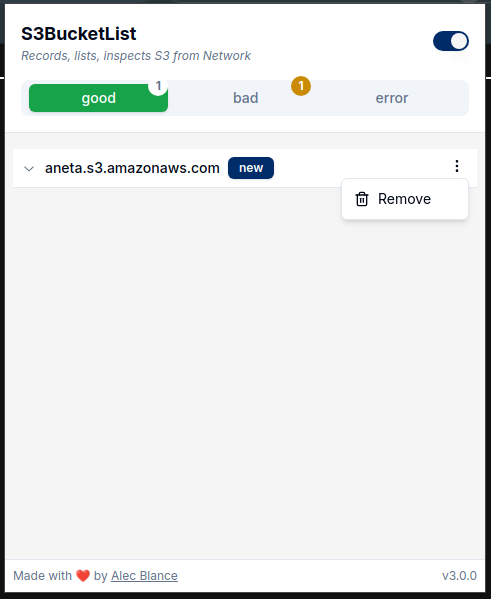

# S3BucketList

Search, lists, and checks S3 Buckets found in network requests while you are browsing.

<a href="https://www.producthunt.com/products/s3bucketlist?embed=true&utm_source=badge-featured&utm_medium=badge&utm_source=badge-s3bucketlist" target="_blank"></a>
&nbsp;&nbsp;
<a href="https://chromewebstore.google.com/detail/s3bucketlist/anngjobjhcbancaaogmlcffohpmcniki" target="_blank">
  
</a> 
&nbsp;&nbsp;
<a href="https://addons.mozilla.org/en-US/android/addon/s3bucketlist/" target="_blank">
  
</a>




## Features

- Filters S3Buckets
- Extract ACL permissions
- Download recorded buckets
- Manage recorded buckets
- Tab-specific bucket recording
- Show missing buckets without assuming their names can be claimed

## Installation

#### Chrome

You can install this extension from the [Chrome Web Store](https://chromewebstore.google.com/detail/s3bucketlist/anngjobjhcbancaaogmlcffohpmcniki?authuser=0&hl=en) or:

1. Download from the [latest](https://github.com/AlecBlance/S3BucketList/releases) release.
2. Extract the downloaded zip file
3. On the top right of the Chrome browser, click the three dots.
4. Select `Extension > Manage Extensions`, and enable `Developer Mode`
5. Click `Load unpacked`, and look for the extracted zip file.

#### Firefox

You can install this extension from the [Firefox add-ons](https://addons.mozilla.org/en-US/android/addon/s3bucketlist/) or:

1. Download from the [latest](https://github.com/AlecBlance/S3BucketList/releases) release.
2. Extract the downloaded zip file
3. In your firefox browser, navigate to `about:debugging > This Firefox > "Load Temporary Addon"`
4. Select the `manifest.json` within the extracted zip file

## Build from source

### Local discovery history

Discovered buckets are saved before checks run, so a failed check does not remove
them. The **This tab** popup shows up to 20 recent discoveries from the active
tab, independent of review status. The green toolbar badge counts new bucket
discoveries for that tab; opening the popup clears the number, not the list.
Tab activity lasts for the browser session and is cleared when the tab closes.
Saved history and **Needs review** stay in the dashboard. Click a bucket to open
its details in the workspace; an existing workspace tab is reused.
The workspace's **Recording settings** button keeps tab-specific recording
available without adding settings to the popup list.

Select a bucket to see first/last seen, sighting count, site
origins, endpoints, and the last observed response status. This information stays
in the extension's local storage; it is not synced. Referring site origins are
excluded from downloads unless you explicitly include them.
Only HTTP(S) origins are kept, with up to 20 sites and endpoints per bucket. Full
URLs, object paths, query strings, credentials, cookies, and request headers are
not stored in this history. Deleting a bucket also deletes its history.

Existing saved buckets still work. Their history starts accumulating on the next
sighting; earlier browsing activity cannot be reconstructed.

### Access results and details

Results now describe the operation: **Can list**, **Listing blocked**,
**ACL readable**, **ACL blocked**, or **Unclear**. A successful file response is
shown as **File seen**, with its browser/signed-link context in Details. It is not
treated as proof of anonymous access. **Bucket not found** does not mean a bucket
name can be claimed. Older saved results can be refreshed using **Scan bucket**.

The workspace defaults to **Needs review**, prioritizing explicit file metadata
access and reported public write grants, then newly allowed access, listing, and
readable ACL evidence. This is a review queue, not a
list of confirmed vulnerabilities: intentionally public datasets can be expected.

**All discoveries** keeps unknown/CDN addresses, blocked results, browser file
responses, signed links, and unchecked page references available without putting
them in the attention list. **Bucket not found** means S3 reported a missing
bucket; it does not mean the name is available.
Status filters work alongside search and use the status shown on the row.
**Queued or checking** also includes rows with an active scan badge. **Scan this
list** only considers eligible buckets in the filtered list.

Select a discovery to see its status and the anonymous checks that actually ran.
**Scan bucket / Scan again** checks listing and bucket access rules. **Test a file**
opens an optional metadata or content check; no file result appears until tested.
**Notes** and **Export** are available directly in the bucket view. Open
**Technical details** for requests, identity, and scan history.
On the first workspace visit, a short note explains what the extension checks,
what it never does, and what it saves. Reopen it under **Workspace tools → About
S3BucketList**, alongside version, Help, Rate, and author information.
Bucket rows open from their full area, including the status text; info buttons and
bulk-selection checkboxes act independently. Status colors remain paired with text:
green for allowed access, red for denied checks or public-write warnings, purple
for unknown bucket identity, amber for uncertainty or missing-bucket leads,
cyan for queued/running checks, and gray
for untested or expected results. These are not whole-bucket safety verdicts.
The toolbar's **Add buckets** accepts explicit targets. **Check queue** under
the discovery tabs shows running and waiting counts, the bucket names, and
recent outcomes. Active states also appear on bucket rows. **Workspace tools** holds
selection, page extraction, and bulk
exports. Add local notes and a status
of **To check**, **Expected**, **Reported**, or **Fixed**. These are your review
labels, not automated retest conclusions. Notes and review labels are excluded
from downloads.

**Export shown** downloads only the current filtered list. To remove multiple
local records, select them and use **Remove selected**; the confirmation lists
the exact records and does not change S3. Notes drafts stay while you switch
buckets in the workspace. Save them before closing the tab.

When reviewing UI changes, walk through the full interaction in a browser with
sample data: opening and returning to a discovery, adding targets, scan progress
and completion, file-tool forms, and errors or empty states. Check narrow layouts
and keyboard focus as well as the default desktop view.

Preserve the original S3 mark and green toolbar count. In the popup, each
bucket is one navigation target with one hover surface; status text adds
context without creating a second surface. The info button keeps its own
focus and action. Check hover on the bucket name, status text, and row padding.

**Mark expected** keeps all evidence but removes the discovery from Needs review.
Repeat sightings and inconclusive checks do not undo it. A newly
confirmed listing/ACL change can reopen review if access still needs attention.
New broad ACL grants also reopen an expected discovery, even when ACL readability
itself has not changed.
Use **Undo expected** to review it again. Failed retests retain earlier confirmed
access evidence; they never count as a fix or trigger age-based rescans.

Detection supports virtual-hosted, path-style, regional, dualstack, website,
accelerated, dotted-name, China, and GovCloud S3 addresses. Known endpoint styles
for one bucket are grouped together without crossing AWS partitions. Checks keep
the known region and partition and do not reuse signed query credentials. Known
S3 URLs can also be recorded when headers never arrive. Custom/CDN names with S3
headers are saved as **Bucket unknown**; the extension does not guess their origin
bucket or run bucket API checks against an invented name. Access points and other
unresolved address types are not treated as ordinary bucket names.

Recording still runs read-only listing/ACL checks automatically for identified
buckets. No passive-only mode was added.

### Checks, history, and handoff

- **Check queue:** two buckets at a time, starts spaced by 500 ms, 8-second request
  timeouts, and a 35-second job limit. Cancel queued or running checks. Queued work
  survives worker restarts; interrupted jobs resume at most once. Failed checks
  require an explicit retry. Up to 200 unfinished and 200 terminal jobs are kept.
- **Check history:** up to 50 snapshots per bucket, preserving the first result
  and first listing/ACL access evidence. Changes are shown per operation. Results
  older than 24 hours are marked outdated, never automatically rescanned for age.
  An unclear retest is not treated as a fix.
- **Extract page:** open **Workspace tools → Extract page references** in the workspace
  and choose an open web tab. The chosen tab briefly becomes active while links,
  resource attributes, and inline configuration are read, then the workspace is
  restored. This does not fetch targets or external scripts. Up to 200 sanitized
  references are saved; these are leads, not confirmed access results.
- **Evidence exports:** versioned JSON includes sanitized check evidence and
  history. Referring site origins are opt-in; local notes, credentials, full URLs,
  object paths, raw headers, and owner IDs are omitted. The JSON download is now
  an envelope with `schemaVersion`, `exportedAt`, and `buckets`.
- **Handoff:** download a Markdown finding draft or known bucket API URLs for
  tools such as Burp. Review destinations before copying unsigned, read-only cURL
  commands. Drafts do not invent severity, impact, or takeover claims.

### Read-only scanner

- A scan makes a `HEAD` bucket-region lookup, then independent listing and ACL
  requests. Each request times out after **8 seconds**. The persistent queue
  retains a **35-second** job limit. A permission request can retry once using a
  validated regional hint in the same AWS partition. Arbitrary redirects are
  never followed, and rate limits/network failures are not permission denials.
  For redirects hidden by Chrome's fetch API, a short-lived observer can recover
  region headers only from this extension's exact matching request. It uses the
  existing `webRequest` permission, not the browser's debugger permission.
- Listing uses `ListObjectsV2` with `max-keys=1`: it checks a real, bounded
  listing request without paging through contents. The sampled name is discarded;
  only whether a name was returned is saved. Response inspection
  stops at **64 KiB**. XML must validate and match the expected S3 root; HTML,
  malformed XML, DTDs, and entities are not accepted as access evidence.
  The result applies to this exact one-key request, not unrestricted listing
  or file-body access. Policies may depend on prefixes or `s3:max-keys`. A changed request
  profile is not presented as a newly opened permission.
- **Request inspector** shows methods, sanitized bucket API destinations,
  HTTP status, allowlisted S3 error codes, region hints, timing, and retries.
  It does not record raw headers, bodies, object paths, or signing credentials.
- **Browse a scoped file listing** makes one explicit `ListObjectsV2` request
  with your exact prefix, `max-keys=20`, and URL-encoded filenames. No pagination
  or automatic file requests. Filenames and the prefix stay in workspace memory,
  not storage, history, or exports; close the preview or leave the bucket to clear
  them. Listing alone does not prove file access. The same 64 KiB body cap applies.
- **Test a file URL** defaults to one credential-free `HEAD` request, only for an
  explicit HTTPS object URL in the selected bucket and partition. No signed
  query, CDN URL, or foreign bucket is accepted. Up to two explicit file tests
  or previews can run separately from the bucket queue. File tests are not
  persisted as jobs: their URL is used in memory only.
- A successful HEAD proves metadata access for the tested file, not that its
  body was downloaded. HEAD `403` can mean inaccessible **or absent**. Because
  object keys are not saved, a later file test may concern another file; a denial
  does not erase earlier positive evidence or claim a fix.
- **Test content access** is a separate, explicit opt-in: one unsigned `GET`
  with `Range: bytes=0-0`. Confirmation requires HTTP 206, matching Content-Range,
  and exactly one received byte. The byte is discarded, never displayed or saved.
  A server that ignores Range is cancelled without reading its body, but may
  already have sent extra bytes. Empty files, ignored ranges, and malformed
  responses remain inconclusive. There is no automatic content test or redirect
  retry. New content proof can reopen a bucket marked expected even if metadata
  access was already known. A later denial cannot retract proof for an unstored key.
- ACL grants for **Everyone** and **Any AWS account** are shown as reported
  configuration. Bucket policies, Object Ownership, and Block Public Access can
  override their effective permissions. No writes, ACL changes, uploads, deletes,
  bulk file downloads, or credential-based account audits are performed. A denied
  administrative request must not be presented as a disabled security control.
- **Add buckets** in the toolbar accepts up to 100 exact names, `s3://` bucket
  roots, or direct S3 bucket URLs. Bare names use commercial AWS; China/GovCloud
  require a regional URL. Inputs are deduplicated and saved without scanning.
  The list’s **Scan** action reviews up to 100 eligible destinations before queueing.
  No names are permuted or brute-forced.
- Copyable cURL and AWS CLI commands are read-only and unsigned. No external
  scanner is downloaded or executed by the extension.

Design references: [S3Scanner](https://github.com/sa7mon/S3Scanner) (separate
permissions, explicit targets, bounded concurrency),
[cloud_enum](https://github.com/initstring/cloud_enum) (discovery is separate
from verification), and AWS's
[ListObjectsV2](https://docs.aws.amazon.com/AmazonS3/latest/API/API_ListObjectsV2.html)
and [HeadObject](https://docs.aws.amazon.com/AmazonS3/latest/API/API_HeadObject.html)
documentation. This is a scoped browser verifier, not a replacement for an
authenticated AWS configuration audit.

Use **Workspace tools → Select multiple buckets** to review destinations and queue
checks together.
Deleting a discovery also deletes its notes, observations, check history, and
queue records. New `scripting`, `activeTab`, and `alarms` permissions support
explicit page extraction and persistent queue recovery.

### Building

1. Clone the repository, and navigate to the S3BucketList folder
2. Install [pnpm](https://pnpm.io/installation)
3. Do `pnpm i` to install the required modules
4. Do `pnpm zip` for chrome-compatible version or `pnpm zip:firefox` for firefox-compatible version.
5. A zip file will be created in the `dist/` folder
6. Follow the manual installation steps above on how to install the extension.

## Automated Chrome Web Store releases

Merge the fix and feature PRs first, then merge the Changesets **Version Packages**
PR when ready to release. After successful CI, the Publish workflow creates the
GitHub release, builds and attaches the Chrome and Firefox ZIPs, and submits the
Chrome ZIP to the existing Chrome Web Store listing. Google still reviews the
update; submission does not mean it is immediately live. Firefox store submission
is not automated by this workflow.

### One-time setup

1. Enable the Chrome Web Store API in a dedicated Google Cloud project and create
   a service account **without Google Cloud project roles**, following the
   [official service-account guide](https://developer.chrome.com/docs/webstore/service-accounts).
2. Add its email in the Chrome Web Store Developer Dashboard under
   **Settings > Service account**. Google grants API access to all items owned by
   that publisher. The release script deliberately fixes the target to
   S3BucketList (`anngjobjhcbancaaogmlcffohpmcniki`).
3. In GitHub, open **Settings > Secrets and variables > Actions** and add:

   | Repository secret | Value |
   | --- | --- |
   | `CHROME_SERVICE_ACCOUNT_KEY` | Full JSON key created for the dedicated service account |
   | `CHROME_PUBLISHER_ID` | Publisher ID from the store dashboard's Settings page |

This is private server-to-server publishing: no public OAuth consent screen,
homepage, privacy-policy URL, client secret, or refresh token is required for
this authentication method. It does not change the extension's store policy
obligations.

Keep the JSON key out of source files, PRs, and logs. Supply the two environment
variables above securely and run this read-only check using Node.js 20 (matching
CI) before the first release:

```sh
node scripts/publish-chrome.mjs --dry-run
```

Missing credentials or a rejected submission fail the Publish workflow visibly.
The GitHub release and ZIPs are created before store submission, so they remain
available if submission fails. Do not bump the version merely to retry an upload
failure: inspect the store status first, then run `node scripts/publish-chrome.mjs
<chrome-zip-path>` from the release's Git tag with the existing release's Chrome
ZIP. The script skips already-published or already-submitted versions, refuses to
replace another pending or staged version, waits for asynchronous uploads, and
blocks publication on store warnings. Google review is not bypassed.

Rotate the service account key periodically. After saving a new key as the GitHub
secret and verifying read access, delete the superseded key in Google Cloud.
Never commit a downloaded key file.
