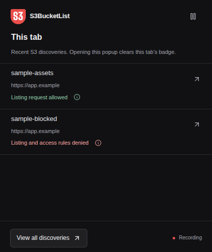
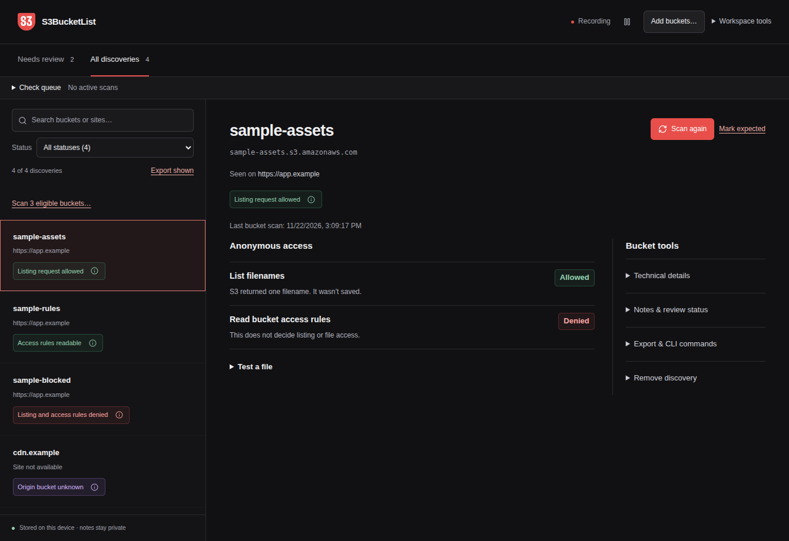

# S3BucketList

Discover Amazon S3 buckets while you browse and check what’s accessible without AWS credentials.

**Install:** [Chrome Web Store](https://chromewebstore.google.com/detail/s3bucketlist/anngjobjhcbancaaogmlcffohpmcniki) · [Firefox Add-ons](https://addons.mozilla.org/en-US/firefox/addon/s3bucketlist/) · [GitHub Releases](https://github.com/AlecBlance/S3BucketList/releases)

## Usage

1. **Browse with recording on.** The toolbar badge counts new discoveries in the current tab. Open the popup to see **This tab** and clear the count.
2. **Open the dashboard.** Select a bucket or click **View all discoveries**. Use **Needs review** for confirmed anonymous access or **All discoveries** to search and filter saved buckets.
3. **Review the results.** **Scan bucket** checks whether filenames can be listed and bucket access rules can be read. **Test a file** checks a specific file. Use **Add buckets** to save known targets without scanning them.

Checks are read-only: no uploads, deletes, or permission changes. Discoveries and notes stay on your device. Only test buckets you’re authorized to check.

## Screenshots

**This tab** — recent discoveries and their status.

**Dashboard** — saved discoveries, anonymous access results, and bucket tools.

*Screenshots use sample data.*
